**Code:** <https://github.com/yusuf0205/pid-control-assignment>. Every graph and number in this document is produced by `python src/make_figures.py` (NumPy and Matplotlib only; the PID logic is written by hand in `src/pid.py`).

# 1. The basic idea

Imagine you step into a shower and the water is too cold. You turn the knob a little towards hot, wait, feel the water again, and turn a little more. When it is just right you stop turning. You have just been a **feedback controller**: you kept measuring the gap between what you want (warm) and what you have (cold), and you kept acting to make that gap smaller.

A machine does the same thing in a loop that repeats many times a second:

1. **Target (setpoint, r):** what we want, for example "block at 1 m".
2. **Sensor:** measures what we actually have, the position **y**.
3. **Controller:** computes the **error** $e = r - y$ and decides how hard to push.
4. **Machine (plant):** receives the push **u** and moves. The sensor measures again and the loop repeats.

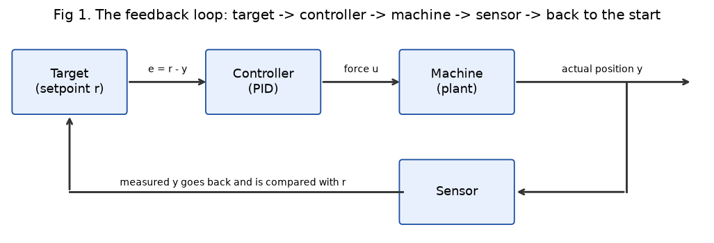{width=80%}

If the block is short of the target the error is positive and the controller pushes forward; if it went too far the error is negative and it pushes back. The loop never needs to know the exact physics; it only needs to keep shrinking the error.

# 2. The PID formula

$$u(t) = K_p\,e(t) + K_i\int_0^t e(\tau)\,d\tau + K_d\,\frac{de(t)}{dt}$$

| Symbol | Meaning | Unit (for our block) |
|---|---|---|
| $u$ | controller output, the force on the block | N |
| $r$, $y$ | target position, measured position | m |
| $e = r - y$ | error | m |
| $K_p$ | proportional gain | N/m |
| $K_i$ | integral gain | N/(m s) |
| $K_d$ | derivative gain | N s/m |

* **P (present error):** push in proportion to how far away we are now. Big gap, big push.
* **I (past error):** adds up the error over time. If a small error refuses to go away, this sum keeps growing until the push is big enough to remove it.
* **D (how fast the error is changing):** if the error is shrinking fast, we are about to overshoot, so D brakes early. It acts like a shock absorber.

**What the computer actually runs.** A computer cannot do continuous calculus; it updates every $\Delta t$ seconds (here 1 ms). At step $k$:

$$e_k = r_k - y_k,\qquad I_k = I_{k-1} + e_k\,\Delta t,\qquad D_k = \frac{e_k - e_{k-1}}{\Delta t}$$
$$u_k = K_p e_k + K_i I_k + K_d D_k$$

The force $u_k$ is held constant until the next update (a "zero-order hold"). The integral becomes a running sum and the derivative becomes a difference of two samples.

# 3. The test system (given)

A 1 kg block on a spring with a damper, like one corner of a car suspension. Newton's second law (sum of forces = mass x acceleration):

$$m\ddot{x} + c\dot{x} + kx = F,\qquad m = 1\ \text{kg},\ c = 10\ \text{N s/m},\ k = 20\ \text{N/m}$$

In Laplace form the plant is $X(s)/F(s) = 1/(s^2 + 10s + 20)$. **Why a constant push is needed:** when the block is resting at $x = 1$ m, velocity and acceleration are zero, so the equation leaves $kx = F$: the spring pulls back with $20 \times 1 = 20$ N, and something must push with exactly 20 N forever to hold it there. Figure 2 shows this: with 20 N the block settles at exactly 1.000 m; when the push is removed the spring pulls it back to 0.

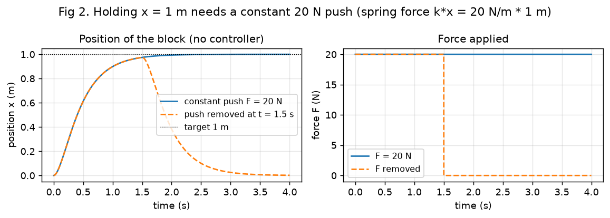{width=88%}

**How the simulation works.** The equation is rewritten as two first-order equations (position and velocity) and stepped forward with 4th-order Runge-Kutta every 0.5 ms. The controller runs every 1 ms and its force is held between updates, just like a real microcontroller driving a motor.

# 4. How to judge a result

* **Rise time:** time to go from 10 % to 90 % of the final value (how fast it rises).
* **Overshoot:** how far it goes past the final value, as a percentage.
* **Settling time:** time after which it stays within $\pm 2$ % of its final value (how long until it calms down).
* **Steady-state error:** target minus final value (how far from the target it finally stops).

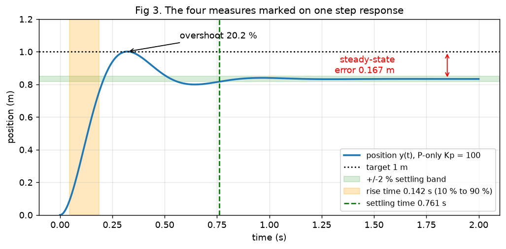{width=78%}

# 5. Each part alone

**P only, and why it always stops short.** With $F = K_p(r - x)$ the closed loop is $\ddot{x} + 10\dot{x} + (20 + K_p)x = K_p r$. At rest, $x_\infty = \frac{K_p}{20 + K_p}r$, so the error is $e_\infty = \frac{20}{20 + K_p}$ m. It can never be zero: the spring needs 20 N, and P only produces force when there is an error, so some error must remain to create that force. The natural frequency is $\omega_n = \sqrt{20 + K_p}$ and the damping ratio $\zeta = 10/(2\omega_n)$, which **falls** as $K_p$ rises, so stronger P bounces more. Overshoot for a second-order system is $e^{-\pi\zeta/\sqrt{1-\zeta^2}}$.

| Kp | final (theory) | final (simulated) | error | $\zeta$ | overshoot theory | overshoot simulated |
|---|---|---|---|---|---|---|
| 10 | 0.333 | 0.333 | 0.667 m | 0.91 | 0.1 % | 0.1 % |
| 50 | 0.714 | 0.714 | 0.286 m | 0.60 | 9.6 % | 9.7 % |
| 100 | 0.833 | 0.833 | 0.167 m | 0.46 | 20.0 % | 20.2 % |
| 300 | 0.938 | 0.938 | 0.063 m | 0.28 | 40.1 % | 40.7 % |

The calculation matches the simulation to three decimals (the small overshoot difference comes from the 1 ms controller update).

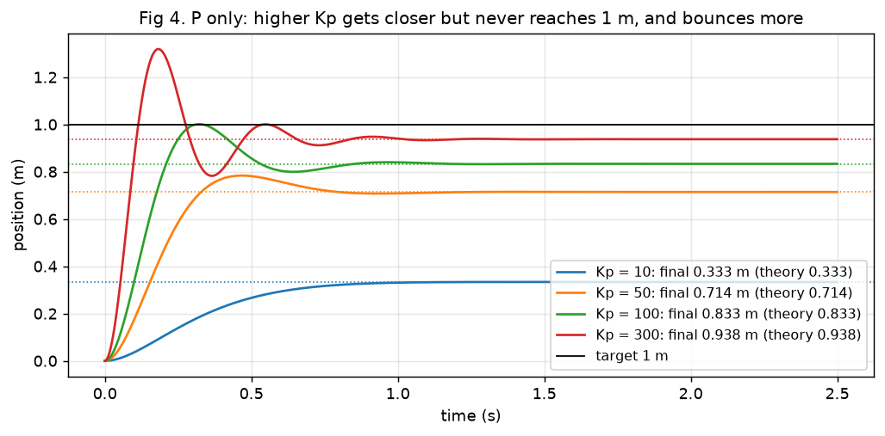{width=78%}

**Adding I.** At rest the I term must stop changing, which only happens when $e = 0$. So the integral grows until it supplies the 20 N the spring needs, and the error goes to zero. With Kp = 300: Ki = 0 stops at 0.938 m; Ki = 200 reaches 1.000 m. The cost is more overshoot (36.9 % at Ki = 200, 55.7 % at Ki = 1000), because the stored sum keeps pushing even after the block passes the target.

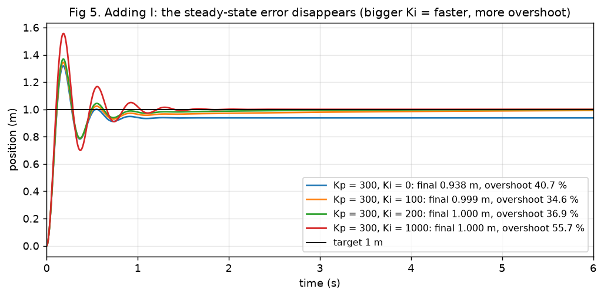{width=78%}

**Adding D.** With D the equation becomes $\ddot{x} + (10 + K_d)\dot{x} + (20 + K_p)x = K_p r$, so D adds directly to the damper: $\zeta = (10 + K_d)/(2\sqrt{20 + K_p})$. For Kp = 300, Kd = 10 gives $\zeta$ = 0.56 and overshoot 12.1 % (theory 12.0 %); Kd = 20 gives $\zeta$ = 0.84 and 0.7 % (theory 0.8 %); Kd = 40 is overdamped (0 %) but slower (rise 0.30 s vs 0.15 s).

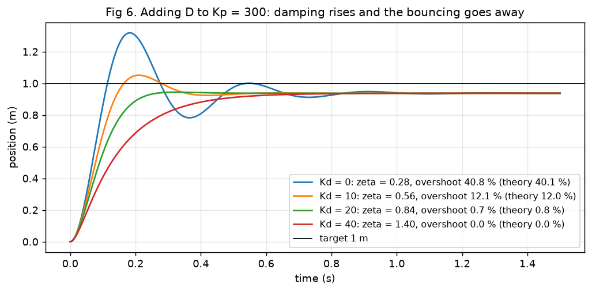{width=78%}

# 6. All together

| Controller | Kp | Ki | Kd | Rise (s) | Overshoot | Settling (s) | Steady-state error |
|---|---|---|---|---|---|---|---|
| P | 300 | 0 | 0 | 0.072 | 40.7 % | 0.78 | 0.063 m |
| PI | 300 | 200 | 0 | 0.075 | 36.9 % | 1.22 | 0.000 m |
| PD | 300 | 0 | 20 | 0.146 | 0.7 % | 0.23 | 0.063 m |
| **PID** | **300** | **200** | **20** | **0.153** | **0.5 %** | **0.24** | **0.000 m** |

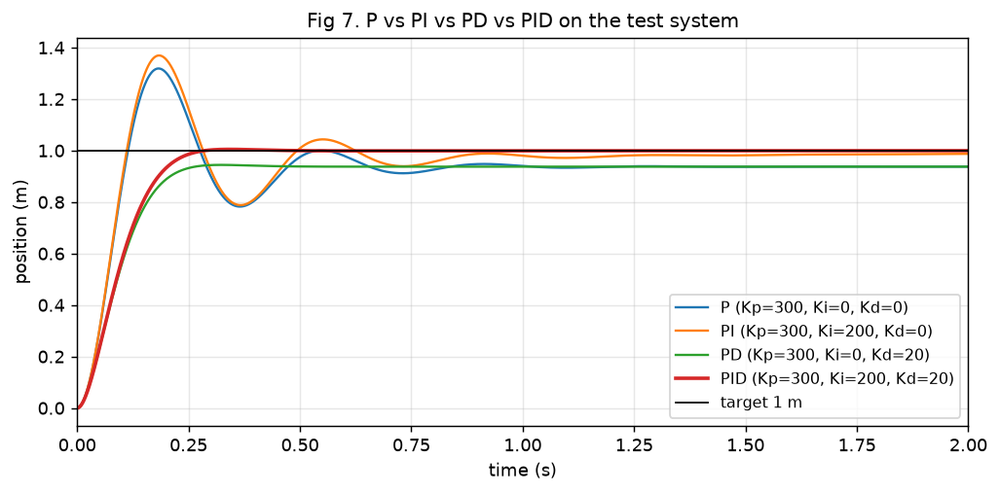{width=78%}

**Final gains: Kp = 300, Ki = 200, Kd = 20.** In a sweep of 36 combinations (Kp 100 to 400, Ki 100 to 400, Kd 10 to 30), this was the fastest one that both reached zero error and kept overshoot under 1 %. Kp = 400 settled slightly faster (0.17 s) but needed a 400 N peak force and still had 1.2 % error after 4 s because its I was weaker. The next section shows the problem with all of these: they ask for 300 N or more at the start.

# 7. Real-world problems

**(a) Windup with a 30 N motor.** The PID above asks for 300 N at the start but the motor gives at most 30 N. While the force is stuck at 30 N the error stays large, and the integral keeps adding it up ("winding up"). When the block finally nears 1 m, that stored integral keeps pushing and it overshoots. **Fix (conditional integration):** if the output is saturated and the error would push it further into saturation, freeze the integral. Result: overshoot 11.2 % to 0.0 %, settling 3.36 s to 2.07 s.

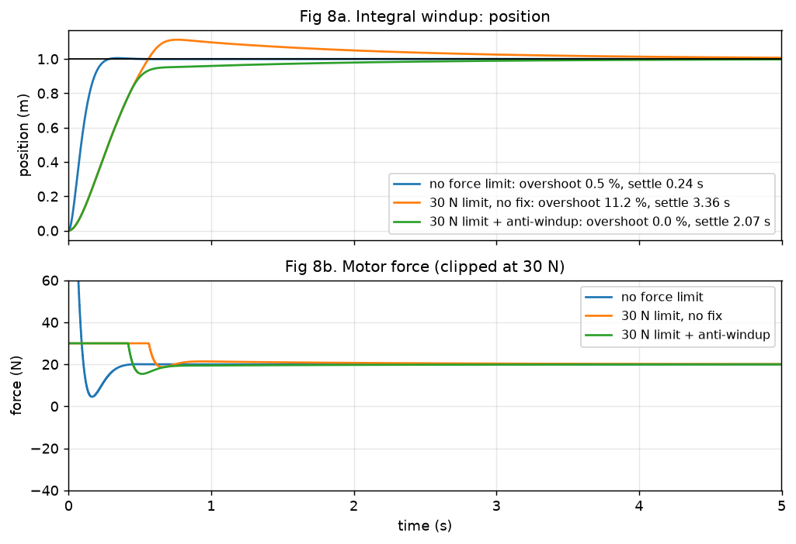{width=78%}

**(b) Noisy sensor ($\pm 1$ mm).** D divides the change in measurement by 1 ms. A random 2 mm jump between two readings looks like a speed of 2 m/s, so Kd = 20 turns it into a 40 N kick, every millisecond. **Fix:** a low-pass filter on the D term, $D_k \leftarrow D_{k-1} + \alpha(D_{raw} - D_{k-1})$, $\alpha = \Delta t/(\tau + \Delta t)$, $\tau$ = 10 ms. The force standard deviation drops from 17.4 N to 1.3 N, while position jitter stays tiny (0.152 mm to 0.135 mm).

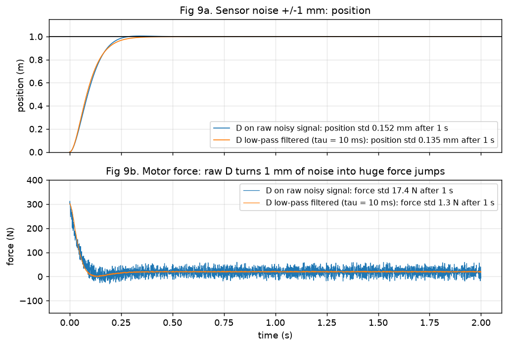{width=78%}

**(c) Derivative kick.** If the target jumps from 0 to 1 m in one step, $de/dt = 1\,\text{m}/0.001\,\text{s} = 1000$ m/s for one sample, and D outputs $20 \times 1000$ = 20,000 N (peak 20,300 N with P). **Fix:** take the derivative of the measurement instead of the error ($-dy/dt$). The block's position cannot jump, so there is no spike; the peak force drops to 300 N.

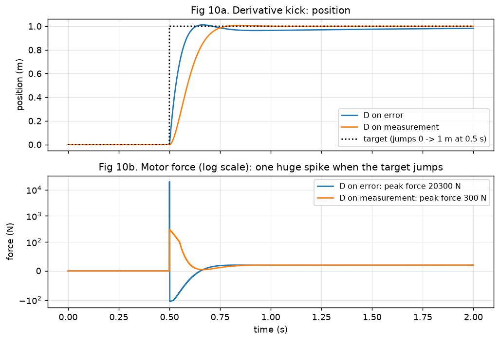{width=78%}

**(d) Updating too slowly.** Between updates the force is frozen, so the controller reacts late, and late corrections arrive out of phase. With the same gains: 1 ms gives 0.5 % overshoot, 20 ms still works (0.0 %; the slower update happens to soften D here), 50 ms rings with 9.0 % overshoot, and beyond about 73 ms the loop is unstable. Rule of thumb: update at least 10 to 20 times faster than the closed-loop response (here $\omega_n \approx$ 18 rad/s, a period of about 0.35 s).

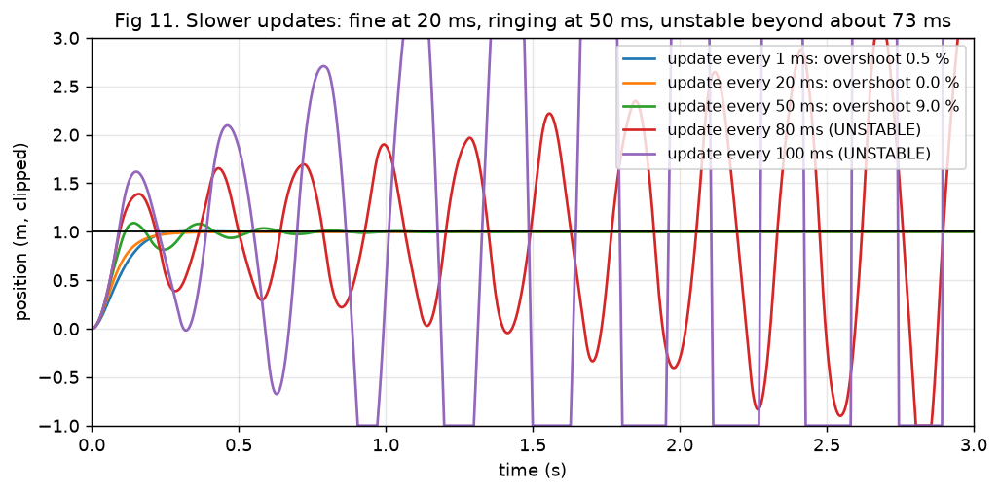{width=78%}

# 8. Choosing the gains

**Hand tuning, step by step.** (1) Set Ki = Kd = 0. (2) Raise Kp until the response is fast but starts to overshoot noticeably. (3) Raise Kd until the overshoot is acceptable (each step adds damping). (4) Raise Ki slowly until the remaining error disappears in a reasonable time; back off if overshoot returns. (5) Check with the real limits on (force limit, noise, update rate) and repeat if needed.

**Ziegler-Nichols.** The recipe is applied to the second test system named in the brief, $G(s) = 1/(s+1)^3$: three 1 second lags in series, the standard ZN textbook plant. The cube matters: a single lag $1/(s+1)$ can never swing steadily under P control, because its closed-loop pole sits at $s = -(1 + K_p)$, always real and stable (Figure 12, left). Theory: oscillation needs a phase of $-180^\circ$, $3\arctan\omega = 180^\circ \Rightarrow \omega = \sqrt{3}$ rad/s, and $|G| = 1/(1+3)^{3/2} = 1/8$, so $K_u = 8$ and $P_u = 2\pi/\sqrt{3}$ = 3.63 s. The simulation (P gain found by bisection until the swing neither grows nor shrinks) gave $K_u$ = 7.88 and $P_u$ = 3.65 s; the small difference is the extra delay of the 10 ms digital update.

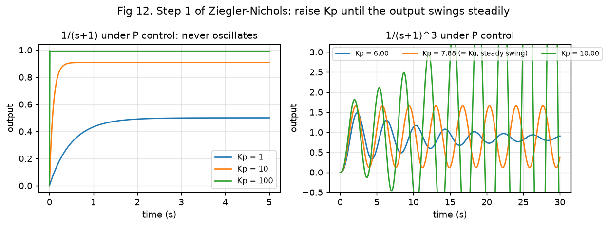{width=92%}

Classic ZN table: $K_p = 0.6K_u$, $T_i = P_u/2$, $T_d = P_u/8$ ($K_i = K_p/T_i$, $K_d = K_pT_d$), giving Kp = 4.73, Ki = 2.59, Kd = 2.16. This is meant to be aggressive: 52.2 % overshoot, settling 9.9 s. **Improved:** lower Kp to $0.36K_u$, slow the integral ($T_i = P_u$) and keep relatively more D ($T_d = P_u/6$): Kp = 2.84, Ki = 0.78, Kd = 1.73, giving 10.1 % overshoot and settling 4.9 s.

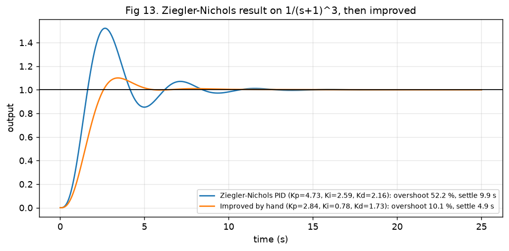{width=78%}

# 9. The code

`src/pid.py` holds a reusable `PID` class with every fix from Section 7 as an option:

```python
c = PID(kp=300, ki=200, kd=20, dt=0.001,
        u_min=-30, u_max=30, anti_windup=True,     # (a) force limit + windup fix
        d_filter_tau=0.01,                          # (b) noise filter on D
        d_on_measurement=True)                      # (c) no derivative kick
u = c.update(setpoint, measurement)                 # call once every dt (d)
```

Inside `update()`: compute the error; compute the rate (from the measurement, then low-pass filtered); compute a candidate integral; add P, I and D; clip to the limits; and if clipped in the direction of the error, discard the new integral. `src/plants.py` holds the block and the $1/(s+1)^n$ plant with an RK4 integrator; `src/sim.py` runs the loop and computes the four measures.

Run on the test system with all real-world effects at once (30 N limit, $\pm 1$ mm noise, 1 ms updates, target 0 to 1 m then down to 0.5 m): rise 0.41 s, overshoot 0.01 %, settling 2.01 s, final error 0.0005 m. The force never exceeds 30 N and has no spikes at either target change.

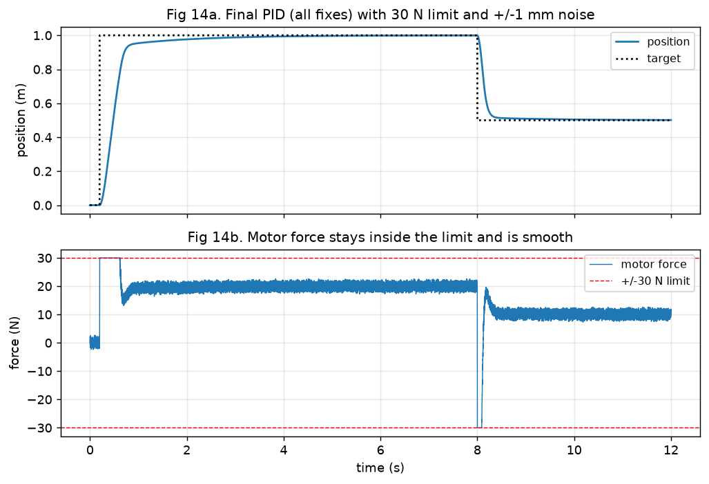{width=78%}

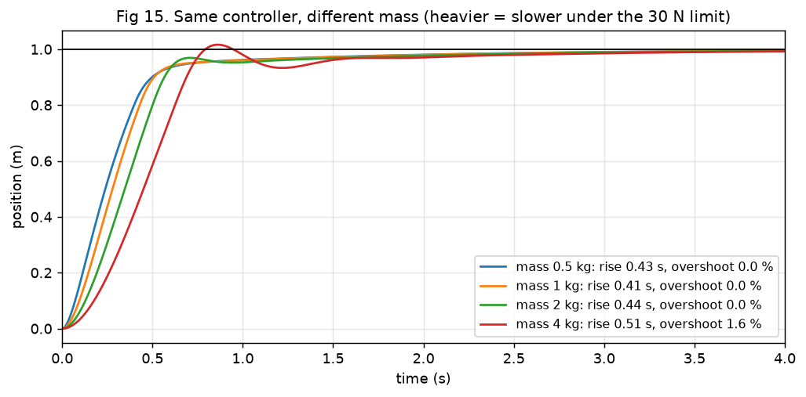{width=78%}

# 10. Real robots and common myths

| System | What PID controls | How it is used |
|---|---|---|
| DC motor speed | wheel RPM | encoder measures speed, PID sets PWM duty; I removes the error from friction and load |
| Drone | roll, pitch, yaw | nested loops: an outer angle PID feeds an inner rate PID at 1 to 8 kHz; D on gyro rate gives stiffness |
| Robot arm | joint angle | each joint has a position PID (often with gravity feed-forward) driving motor current |
| Line follower | sideways offset from the line | sensor array gives the offset; PID sets the speed difference between the two wheels |
| Car cruise control | road speed | throttle from PID with anti-windup, so climbing a hill does not cause a speed overshoot afterwards |

**Myths, corrected.**

1. *"More gain is always better."* Higher Kp is faster but bounces more and can go unstable (Fig 4, Fig 11).
2. *"P alone can reach the target."* Not when the plant needs a constant force; the error is $20/(20 + K_p)$ m here (Sec 5).
3. *"D always helps."* D amplifies sensor noise and causes kick unless it is filtered and taken on the measurement (Fig 9, Fig 10).
4. *"Ziegler-Nichols gives the final gains."* It gives a deliberately aggressive starting point (52 % overshoot here) that needs refinement (Fig 13).
5. *"The update rate does not matter if the gains are right."* The same gains go from 0.5 % overshoot to unstable when updates slow from 1 ms to 80 ms (Fig 11).

# Write-up: approach, what worked, what did not, what next

**Approach.** Model first, then predict by hand, then simulate, then compare. Every claim in Sections 5 and 8 has a formula and a matching simulated number.

**What worked.** The hand calculations matched the simulation closely (P-only final positions identical to 3 decimals; overshoot within 0.6 %). The three fixes each removed their problem cleanly (overshoot 11.2 % to 0.0 %, force noise 17.4 N to 1.3 N, kick 20,300 N to 300 N).

**What did not work perfectly.** With the 30 N limit and anti-windup, the block reaches 0.95 m quickly but then creeps to 1 m (settling 2.07 s), because the frozen integral must rebuild slowly. The ZN result on $1/(s+1)^3$ also needed refinement: the classic table gives 52% overshoot, so the gains were retuned by hand to about 10%.

**What I would explore next.** Back-calculation anti-windup to remove the slow creep; a feed-forward term ($F_{ff} = k\,r$ = 20 N) so the integral only fixes model error; a setpoint ramp to stay inside the 30 N limit; and tuning for the noisy, limited system directly with an optimiser on settling time.

**AI use.** I used an AI assistant to help structure the code and draft and proofread the text. All numbers come from running the code in the repository and were checked against the hand calculations above.
